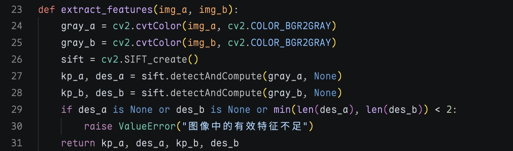
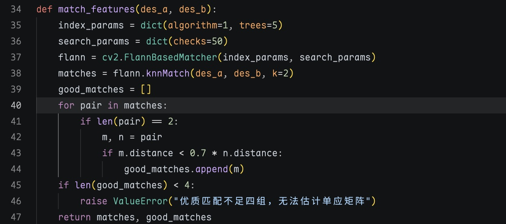
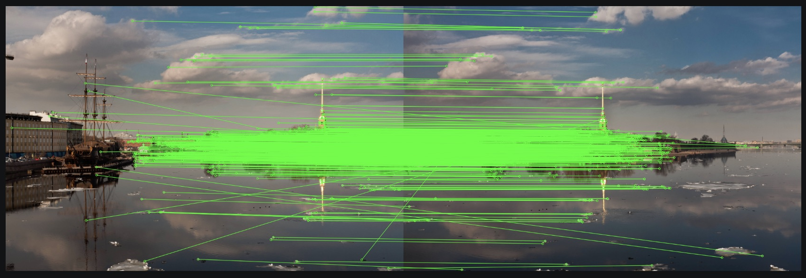
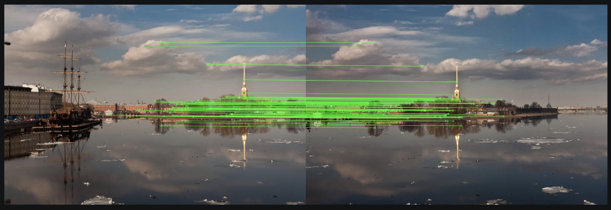
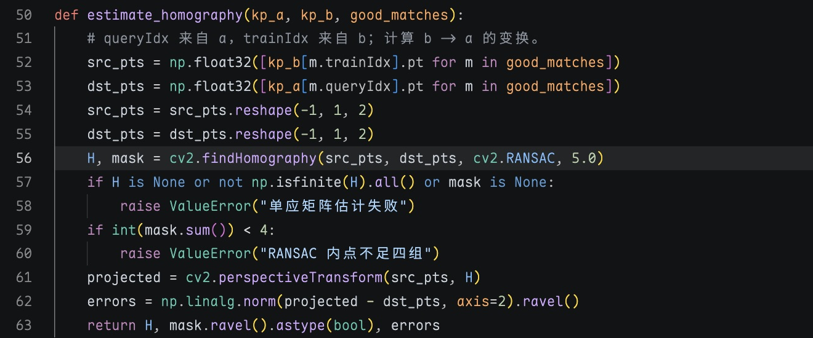
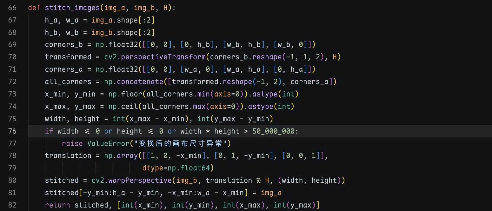
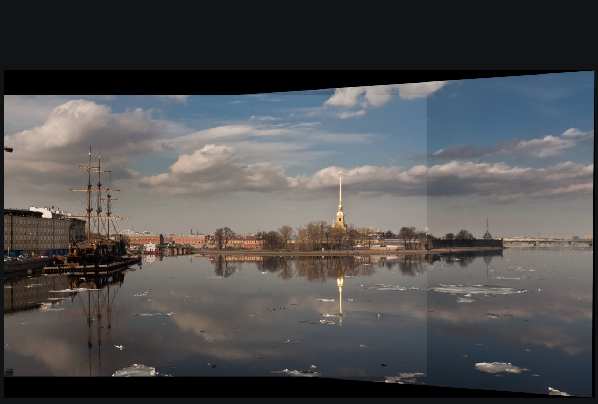
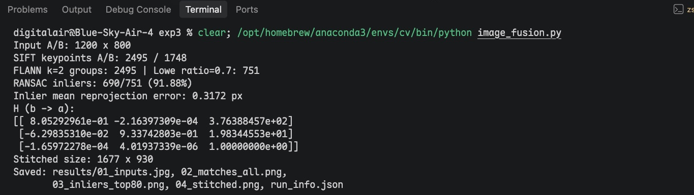

# 实验三：特征匹配与图像拼接

## 一、实验目的

1. 掌握使用 OpenCV SIFT 检测关键点和计算描述符的方法。
2. 使用 FLANN 和 Lowe 比率测试筛选两幅图像的对应特征。
3. 通过 RANSAC 估计单应矩阵，完成透视变换和图像拼接。

## 二、实验环境

- 操作系统：macOS，Apple Silicon
- 实验工具：VS Code，集成终端及图像预览
- Python 环境：已有 Conda `cv`，Python 3.12.14
- 主要依赖：OpenCV 5.0.0（opencv-python 5.0.0.93）、NumPy 2.5.3
- 实验依据：《实验三参考代码.pdf》中的 `image_fusion.py`

## 三、实验内容

### 1. 读取图像并提取 SIFT 特征

实验用的是 OpenCV `opencv_extra` 仓库里的两张图片 `boat1.jpg` 和 `boat2.jpg`，下载后改名为 `a.jpg`、`b.jpg`。

两张原图都是 3888×2592，尺寸比较大，所以程序读取后用 `INTER_AREA` 缩小到 1200×800，再转成灰度图。下面左边是 a，右边是 b。


这里用 `cv2.SIFT_create()` 创建 SIFT 检测器，再用 `detectAndCompute` 分别提取两张图的关键点和描述符。

```python
gray_a = cv2.cvtColor(img_a, cv2.COLOR_BGR2GRAY)
gray_b = cv2.cvtColor(img_b, cv2.COLOR_BGR2GRAY)
sift = cv2.SIFT_create()
kp_a, des_a = sift.detectAndCompute(gray_a, None)
kp_b, des_b = sift.detectAndCompute(gray_b, None)
```



运行后图 a 检测出 2495 个关键点，图 b 检测出 1748 个。

### 2. 使用 FLANN 进行特征匹配

FLANN 这部分基本按参考代码来，使用 KD-tree，参数设为 `algorithm=1`、`trees=5`、`checks=50`。`k=2` 表示每次从图 b 中找两个最近邻描述符。

然后做 Lowe 比率测试，只有最近邻距离小于第二近邻距离的 0.7 倍，才把这组匹配留下来。



一共查询了 2495 组，经过 0.7 比率测试后剩下 751 组。下面是全部匹配的截图，连线比较密，也有一些明显交叉的线，说明还是会有误匹配。



全部画出来不太好看清，所以又从 RANSAC 的内点里按描述符距离选了前 80 组单独画图。实际计算单应矩阵时用的还是前面筛选出的 751 组匹配。



### 3. 使用 RANSAC 估计单应矩阵

匹配结果里的 `queryIdx` 是图 a，`trainIdx` 是图 b。这里要把 b 拼到 a 上，所以用 b 的点作为源点，a 的点作为目标点，求 b 到 a 的单应矩阵。代码如下：

```python
H, mask = cv2.findHomography(src_pts, dst_pts, cv2.RANSAC, 5.0)
```

这里的 `5.0` 是 RANSAC 的重投影误差阈值，单位是像素（按缩小后的图像计算）。它会把不符合几何关系的一部分匹配点排除掉。



运行结果有 690 组内点，占 751 组匹配的 91.88%，另外 61 组不属于内点。得到的矩阵如下：

```text
H（b → a）=
[[ 8.05292961e-01  -2.16397309e-04   3.76388457e+02]
 [-6.29835310e-02   9.33742803e-01   1.98344553e+01]
 [-1.65972278e-04   4.01937339e-06   1.00000000e+00]]
```

这些内点的平均重投影误差是 0.3172 像素，说明这次数据拟合得还可以。不过这个误差只对应本次使用的图片。

### 4. 透视变换与图像拼接

先用 `perspectiveTransform` 算出图 b 四个角点变换后的位置，再把图 a 的四个角点一起算进去，确定拼接图需要多大的画布。边界用了向下、向上取整，防止裁掉边缘。

算出的边界是 `(x_min, y_min, x_max, y_max) = (0, -70, 1677, 860)`，其中 y 出现了负数。所以先把画面向下平移 70 像素，再用 `warpPerspective` 变换图 b，最后把图 a 放到对应位置。两张图重叠的地方直接用图 a 覆盖。



这里还是按参考代码直接覆盖，没有做羽化、曝光补偿等处理。输出图片大小为 1677×930。



最后的图比原来单张照片宽，左边的船和右边的河岸都能看到。建筑和岸边基本接上了，但是天空和水面有比较明显的接缝，应该是两张照片亮度不同，加上直接覆盖造成的。上下还有黑色空白区域，这次没有额外裁剪。

### 5. 实际运行记录

在 `CS Virtual/exp3` 目录里用之前配置好的 `cv` 环境运行，生成的结果放在 `results/`。下面是 VS Code 终端运行的截图。



## 四、实验结果

| 项目 | 实际结果 |
| --- | --- |
| 原始图像尺寸 | 两幅均为 3888×2592 |
| 参与计算的图像尺寸 | 两幅均为 1200×800 |
| SIFT 关键点数量 a / b | 2495 / 1748 |
| FLANN 近邻查询组数 | 2495 |
| 0.7 比率测试后匹配数 | 751 |
| RANSAC 内点数 | 690 |
| 内点比例 | 91.88% |
| 内点平均重投影误差 | 0.3172 像素 |
| 拼接图像尺寸 | 1677×930 |

这次程序能够正常提取特征、匹配点、计算单应矩阵并生成拼接图。上面的数字和截图都是同一次运行的结果，相关图片也保存下来了。


## 五、实验总结

这次实验主要是把 SIFT、FLANN 和 RANSAC 连起来实际跑了一遍。它们分别的作用是先找特征点，再匹配，最后用 RANSAC 去掉一部分错误匹配。

写代码时比较容易弄错的是单应矩阵的方向。因为这次是将图 b 变换到图 a，所以源点和目标点不能反过来。另外变换后会有负坐标，画布不能直接按原图尺寸设置，不然一部分内容会被截掉。


## 参考资料

1. 本次上传的[实验三参考代码](reference/实验三参考代码.pdf)。
2. [OpenCV 官方拼接样例图片目录](https://github.com/opencv/opencv_extra/tree/4.x/testdata/stitching)，本次使用 boat1.jpg、boat2.jpg，获取日期为 2026-10-22。
3. [OpenCV 官方图像拼接示例说明](https://docs.opencv.org/5.0/tutorials/others/stitcher.html)。本实验只采用其中的样例图片，算法流程按课程参考代码实现。
