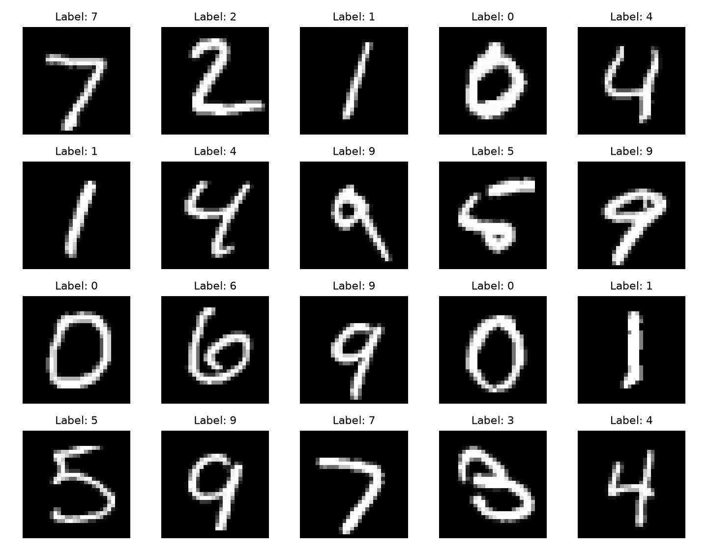
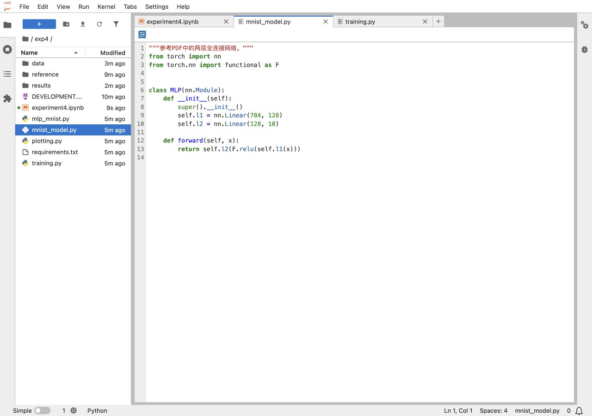
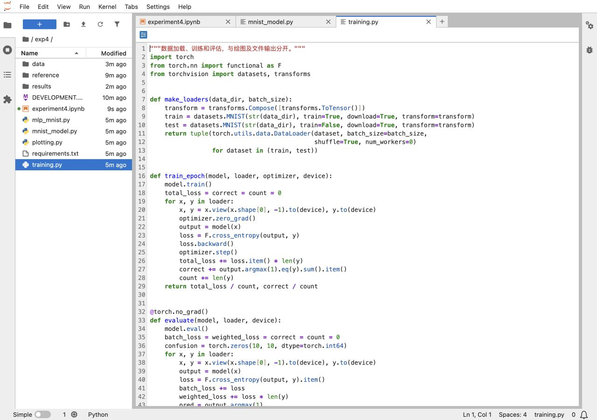
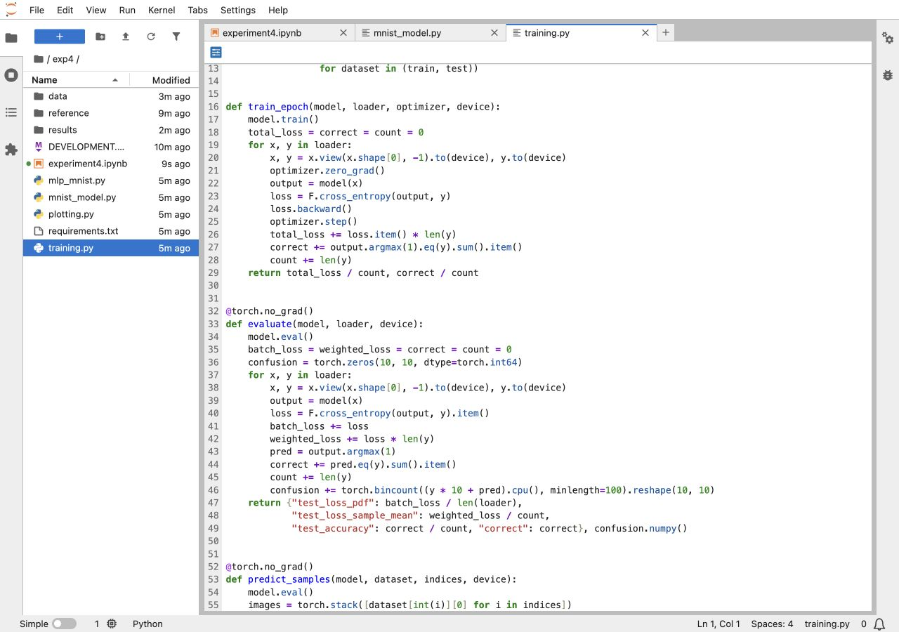
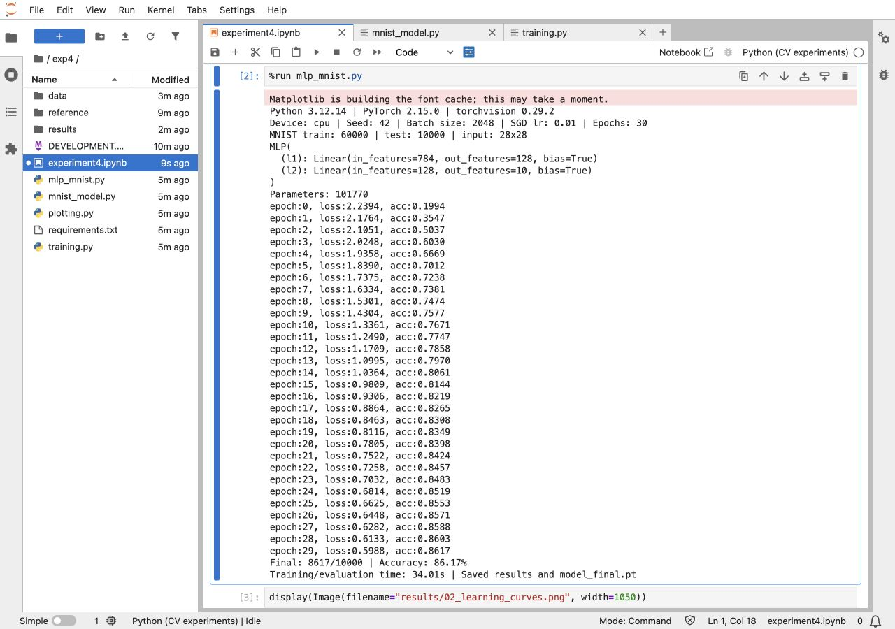
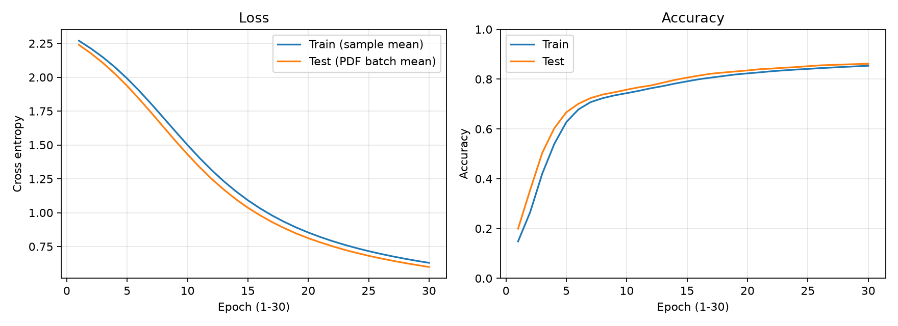
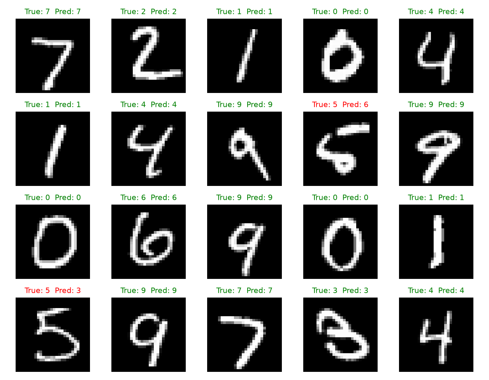
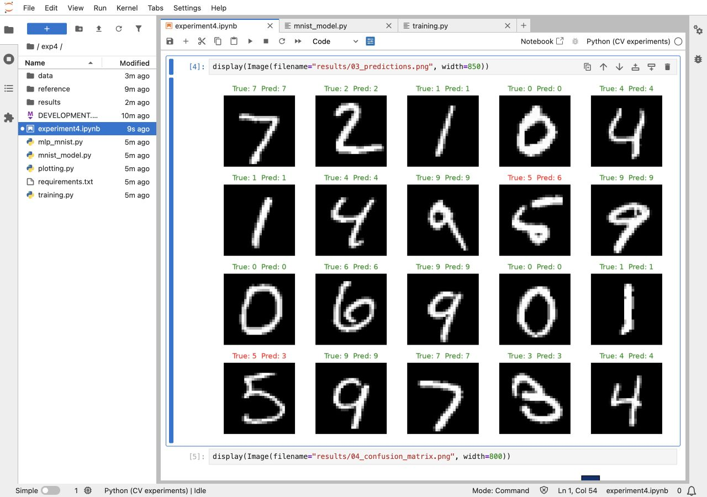
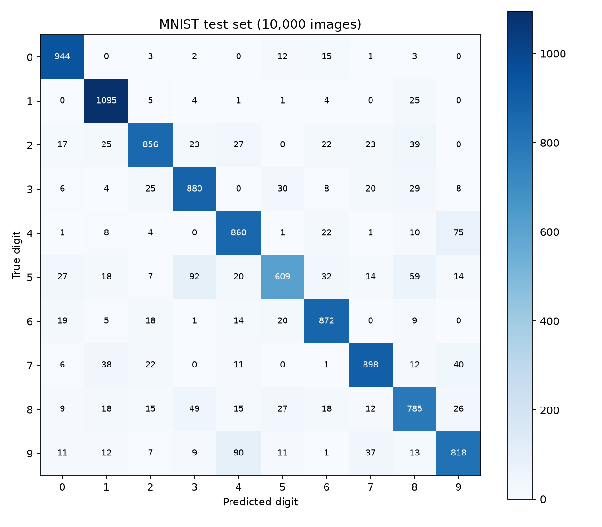

# 实验四：基于多层感知机的手写数字识别

## 一、实验目的

1. 学习使用 PyTorch 读取 MNIST 数据集并搭建全连接网络。
2. 熟悉前向传播、交叉熵损失、反向传播和参数更新过程。
3. 查看训练损失和识别准确率的变化。

---

## 二、实验环境

- macOS（Apple Silicon），Python 3.12.14。
- PyTorch 2.15.0、torchvision 0.29.2、NumPy 2.5.3、Matplotlib 3.11.2。
- 在项目虚拟环境中使用 CPU 训练，Notebook 中保存运行结果。
- 参考代码：《实验四参考代码.pdf》中的 `mlp_mnist.py`。

---

## 三、实验内容

### 1. 读取 MNIST 数据

使用 torchvision 加载 MNIST 数据集，其中训练集有 60000 张图像，测试集有 10000 张，图像大小均为 28×28。通过 `ToTensor()` 将像素值转换到 [0, 1]，批量大小设置为 2048，训练集和测试集的 DataLoader 均开启随机打乱。

测试集前 20 张原始图像如下：



### 2. 搭建网络

将图像展平为 784 维向量，经过包含 128 个神经元的隐藏层和 ReLU 激活函数，最后输出 10 个类别的分数。模型共有 101770 个可训练参数。

```python
self.l1 = nn.Linear(784, 128)
self.l2 = nn.Linear(128, 10)

def forward(self, x):
    return self.l2(F.relu(self.l1(x)))
```

输出层不加 Softmax，直接将结果交给交叉熵损失函数。



### 3. 训练与评估

优化器使用 SGD，学习率设为 0.01，共训练 30 轮。每个批次依次清空梯度、计算损失、反向传播和更新参数。每轮结束后使用测试集计算损失和准确率，测试时调用 `model.eval()` 和 `torch.no_grad()`。





随机种子设置为 42，记录每轮训练结果，并保存第 30 轮的模型。程序中的 `epoch:29` 对应第 30 轮。



### 4. 观察结果

训练过程中，训练损失和测试损失整体下降，准确率逐渐提高。第 1 轮测试准确率为 19.94%，第 30 轮为 86.17%，后期提升速度有所减慢。



使用训练完成的模型预测测试集前 20 张图像，其中 18 张识别正确。两张数字 5 分别被识别为 6 和 3。图中绿色表示正确，红色表示错误。





从混淆矩阵可以看到，数字 1 正确识别了 1095 张；有 92 张数字 5 被识别为 3，数字 4 和 9 也存在一定的混淆。



---

## 四、实验结果

| 训练轮次 | 测试损失 | 测试准确率 |
| --- | --- | --- |
| 1（epoch:0） | 2.2394 | 19.94% |
| 5（epoch:4） | 1.9358 | 66.69% |
| 10（epoch:9） | 1.4304 | 75.77% |
| 15（epoch:14） | 1.0364 | 80.61% |
| 20（epoch:19） | 0.8116 | 83.49% |
| 25（epoch:24） | 0.6814 | 85.19% |
| 30（epoch:29） | 0.5988 | 86.17% |

第 30 轮测试集共识别正确 8617 张，错误 1383 张，准确率为 86.17%。全部训练记录保存在 `results/history.csv`。

测试损失按参考代码对 5 个批次的平均损失取均值，第 30 轮为 0.5988；按样本数加权计算时为 0.5996。

---

## 五、实验总结

本次实验使用 PyTorch 完成了 MNIST 数据读取、MLP 模型搭建、训练和测试。训练 30 轮后，测试准确率达到 86.17%。从预测结果和混淆矩阵来看，模型能识别大部分手写数字，但对部分形状相近的数字容易判断错误。

实验中熟悉了全连接网络的训练流程，也了解了交叉熵损失和反向传播在分类任务中的使用。当前模型结构比较简单，后续可以尝试调整隐藏层大小、学习率或训练轮数，观察准确率的变化。

---

## 复现与文件说明

```bash
cd '/Users/digitalair/CS Virtual/exp4'
.venv/bin/python mlp_mnist.py
```

`experiment4.ipynb` 保存运行输出，`mlp_mnist.py` 为主程序，`mnist_model.py` 定义网络，`training.py` 包含数据处理和训练代码，`plotting.py` 用于生成结果图。

`results/model_final.pt` 保存最终模型，`results/run_info.json` 保存运行信息，`screenshots/` 保存代码和运行截图，MNIST 数据存放在 `data/MNIST/raw/`。

如需重新配置环境，使用 Python 3.12 创建虚拟环境后执行 `python -m pip install -r requirements.txt`，并为 Notebook 选择对应的 Python 内核。

参考资料：[torchvision MNIST](https://docs.pytorch.org/vision/main/generated/torchvision.datasets.MNIST)、[PyTorch CrossEntropyLoss](https://docs.pytorch.org/docs/stable/generated/torch.nn.CrossEntropyLoss.html)。
