# 实验五：基于LeNet的手写数字识别

## 一、实验目的

1. 掌握使用PyTorch搭建卷积神经网络的方法。
2. 理解卷积、Sigmoid激活、平均池化和全连接层的作用。
3. 在MNIST上完成训练和识别，观察卷积层提取的特征。

## 二、实验环境

- macOS，Apple Silicon，Python 3.12.14。
- PyTorch 2.15.0，torchvision 0.29.2，NumPy 2.5.3，Matplotlib 3.11.2。
- 使用实验四已有Python环境，在CPU上训练，Jupyter Notebook保存实际输出。
- 实验依据：[实验五参考代码.pdf](reference/实验五参考代码.pdf)。

## 三、实验内容

### 1. 读取MNIST数据

使用训练集60000张、测试集10000张，每张图像大小为28×28，只有一个灰度通道。通过`ToTensor()`将像素缩放到[0,1]，批量大小设为512，训练和测试数据加载器都按参考代码随机打乱。这次直接复用实验四已下载的数据，原始文件保存在本实验的`data/MNIST/raw/`中。

下面是按原始顺序取出的前20张测试图像，来自MNIST公开数据集。

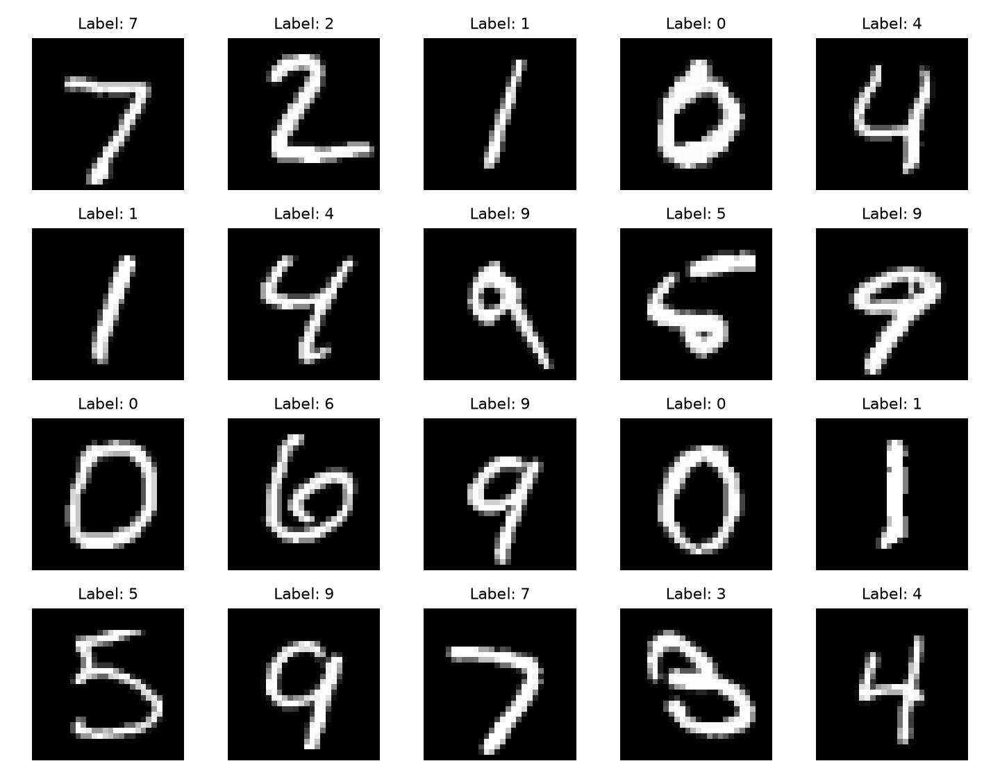

### 2. 补全LeNet网络

按参考代码设置两层卷积和三层全连接。第一层卷积使用padding=2，保持28×28的尺寸；第二层不补零。两次平均池化都使用2×2窗口、步长2。

| 层 | 设置 | 输出尺寸（不含批次） |
| --- | --- | --- |
| 输入 | 灰度图像 | 1×28×28 |
| 卷积1 | 1→6，5×5，padding=2，Sigmoid | 6×28×28 |
| 平均池化1 | 2×2，步长2 | 6×14×14 |
| 卷积2 | 6→16，5×5，Sigmoid | 16×10×10 |
| 平均池化2 | 2×2，步长2 | 16×5×5 |
| 展平 | 从第1维开始 | 400 |
| 全连接1 | 400→120，Sigmoid | 120 |
| 全连接2 | 120→84，Sigmoid | 84 |
| 分类层 | 84→10 | 10 |

网络共有61706个可训练参数。分类层直接输出10个类别分数，交叉熵函数接收logits。

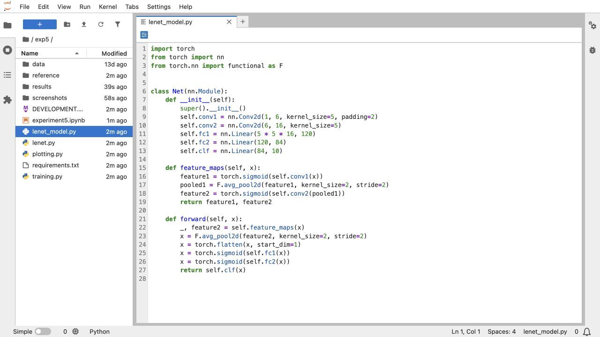

### 3. 训练与评估

使用Adam优化器，学习率为0.01，训练30轮。每批清空梯度，前向计算、计算交叉熵、反向传播并更新参数。训练前设置随机种子42。

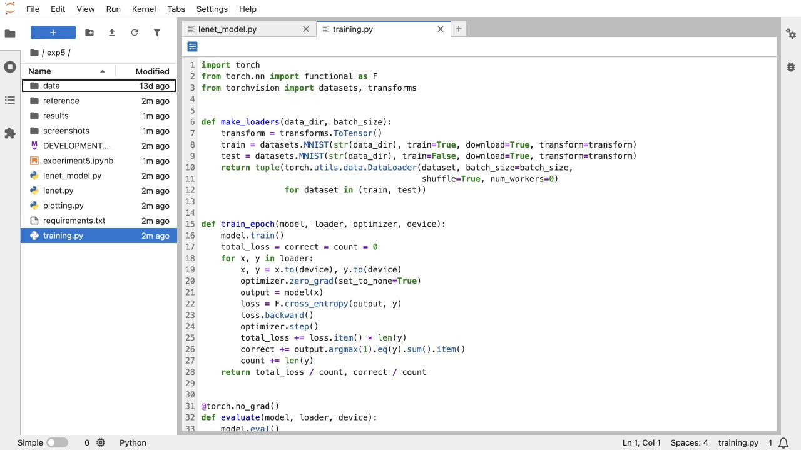

每轮结束后在完整测试集上统计损失和准确率，评估时切换为`eval()`并关闭梯度计算。保存第30轮模型。

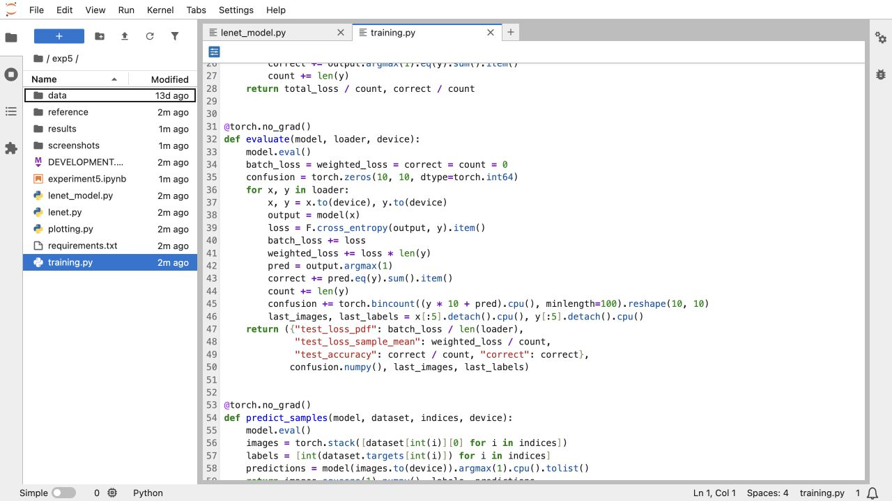

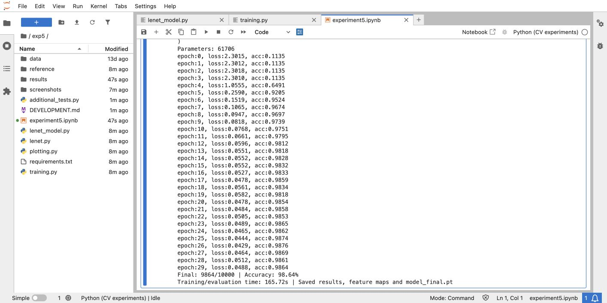

训练开始的前4轮测试准确率都为11.35%，第5轮上升到64.91%，之后继续提高。损失和准确率曲线如下，横坐标使用第1至30轮，日志中的epoch从0开始。

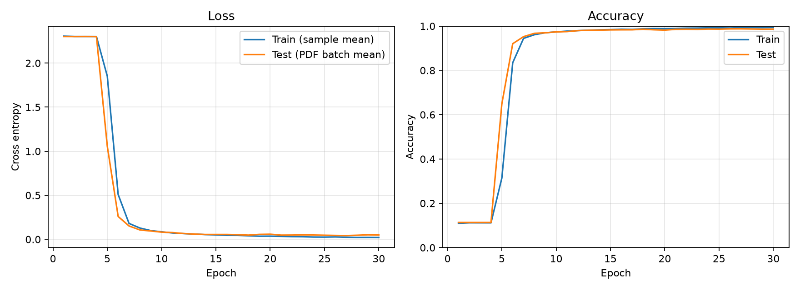

### 4. 查看识别结果

使用第30轮模型识别测试集最前面的20张图像，其中20张正确。绿色标题表示正确，红色表示错误。

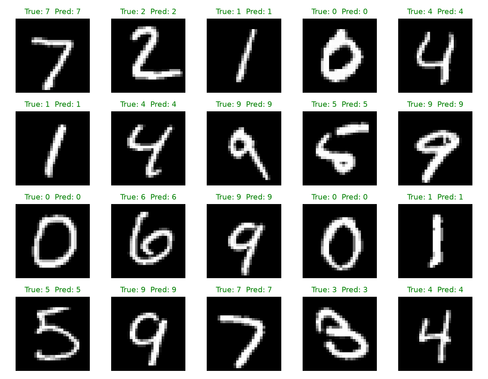

混淆矩阵的行表示实际类别，列表示预测类别。错误包括数字9被识别为8（16张）、数字9被识别为4（11张）、数字5被识别为3（8张）。

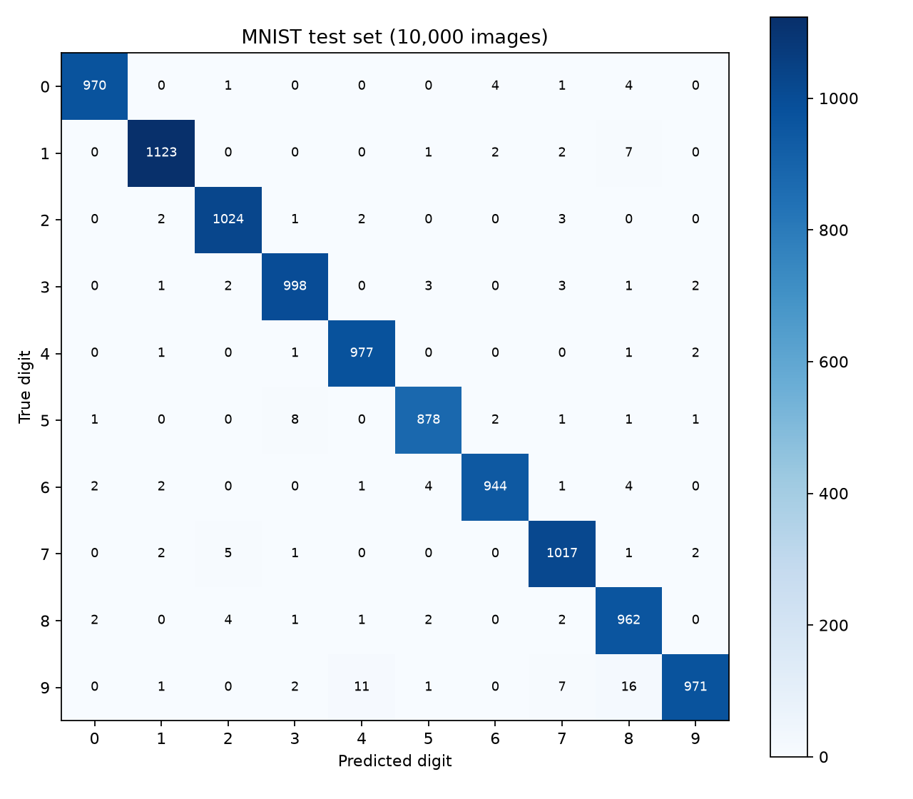

### 5. 显示卷积特征图

按参考代码取最后一个测试批次的前5张图像。第一行是原图，第二行是第一层卷积经Sigmoid后的6个通道之和，第三行是第二层卷积经Sigmoid后的16个通道之和。两层特征尺寸分别为28×28和10×10；

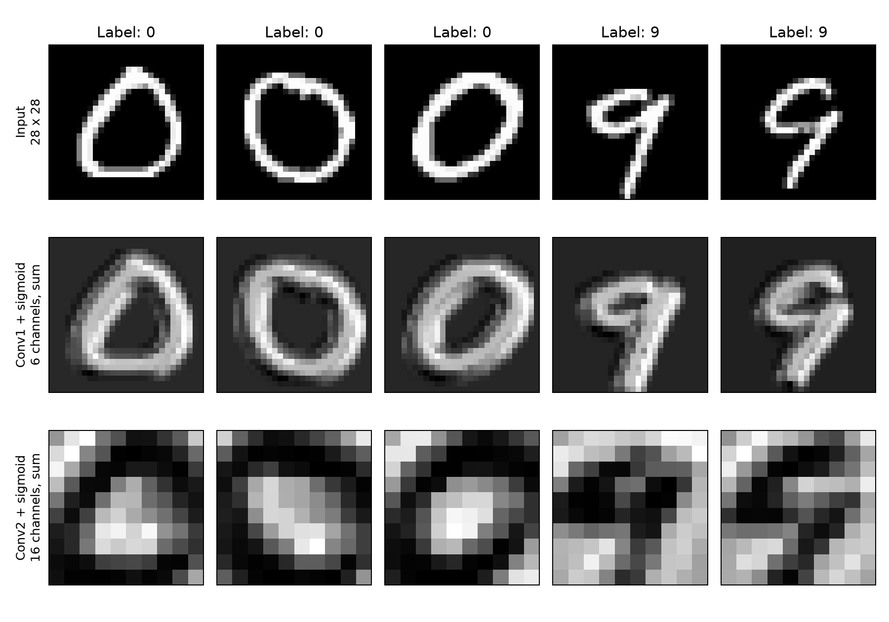

特征图中可以看到笔画位置和局部轮廓的变化。每个子图按自身数值范围显示为灰度，通道求和用于观察整体响应。完整的6通道、16通道激活保存在`results/feature_maps.npz`。

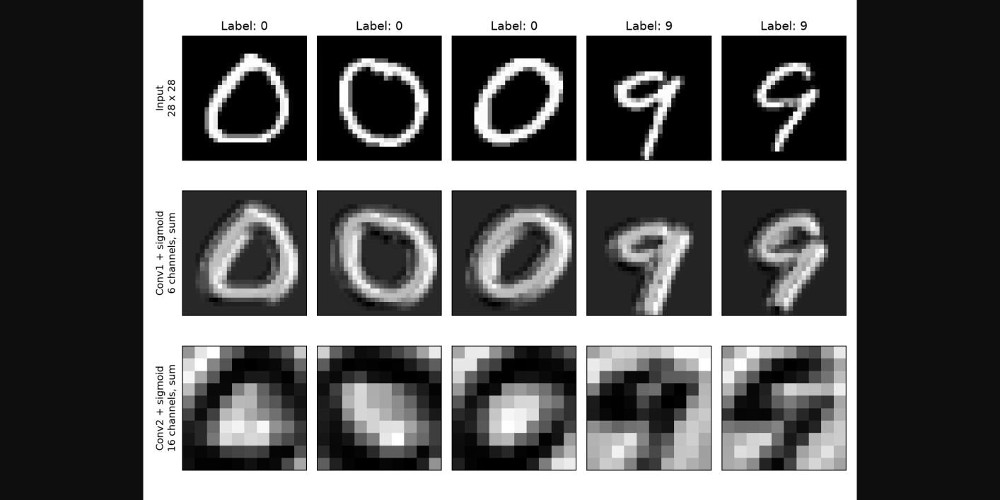

### 6. 增加两组数据测试

继续使用第30轮模型，选取测试集第21–40张、第41–60张，每组20张。

| 组别 | 测试集索引（从0开始） | 正确数 | 准确率 |
| --- | --- | --- | --- |
| 第1组 | 20–39 | 20/20 | 100.00% |
| 第2组 | 40–59 | 20/20 | 100.00% |

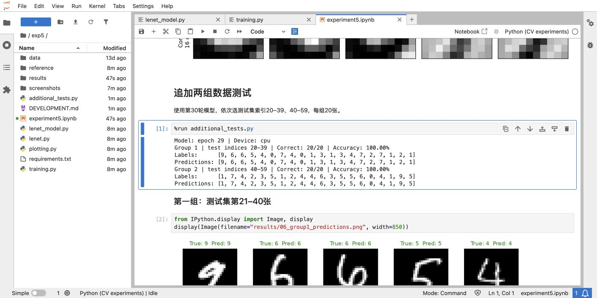

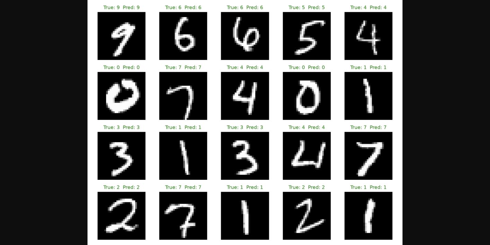

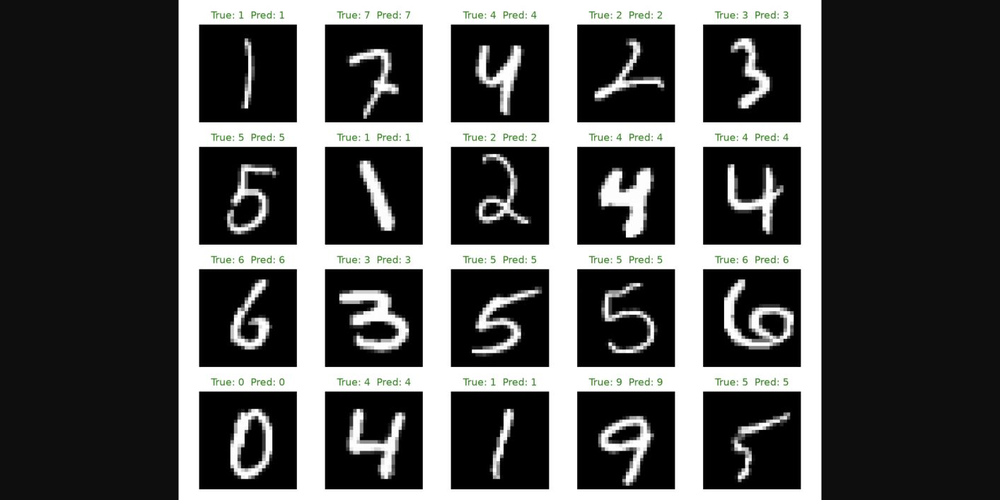

两组样本共40张，全部识别正确；完整10000张测试集准确率仍为98.64%。

## 四、实验结果

| 训练轮次 | 测试损失 | 测试准确率 |
| --- | --- | --- |
| 1（epoch:0） | 2.3015 | 11.35% |
| 5（epoch:4） | 1.0555 | 64.91% |
| 10（epoch:9） | 0.0818 | 97.39% |
| 15（epoch:14） | 0.0552 | 98.28% |
| 20（epoch:19） | 0.0582 | 98.18% |
| 25（epoch:24） | 0.0465 | 98.62% |
| 30（epoch:29） | 0.0488 | 98.64% |

最终正确识别9864张，错误136张，准确率为**98.64%**。

表中测试损失沿用参考代码的批次均值：计算每批平均损失，然后对20批求平均。最后一批为272张，其余19批为512张，因此与按10000张图像加权的均值略有区别。第30轮两者分别为0.048789和0.048573。

## 五、实验总结
这次实验补全了LeNet网络，并完成了MNIST训练、测试和卷积特征图显示。卷积层在局部区域提取特征，池化缩小空间尺寸，再由全连接层完成分类。随着训练进行，测试损失整体下降，识别准确率提高，少量写法接近的数字会混淆。

